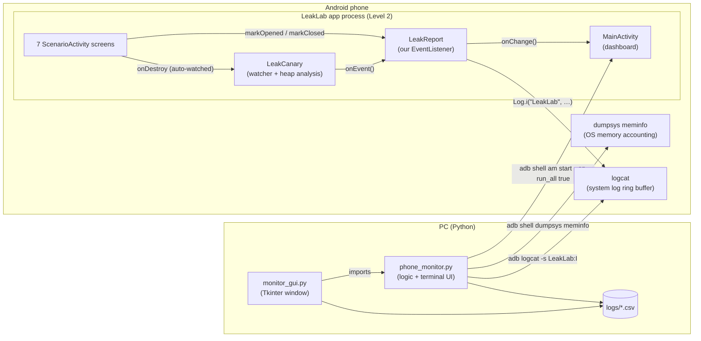
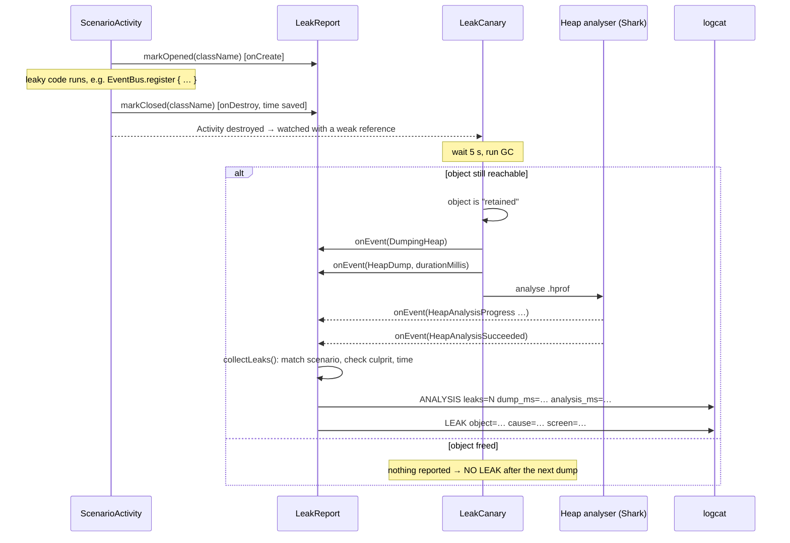
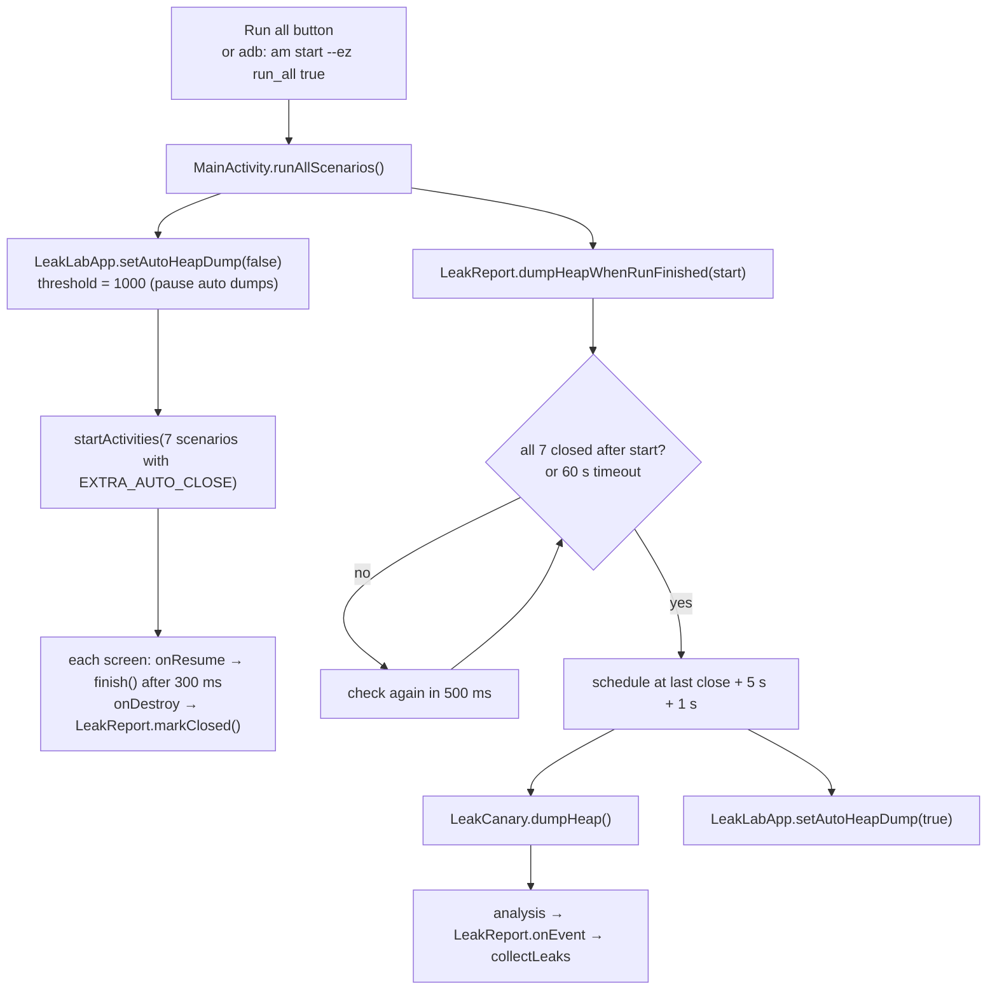
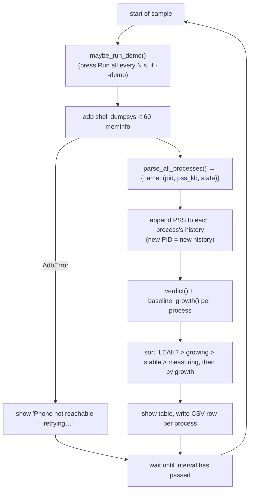
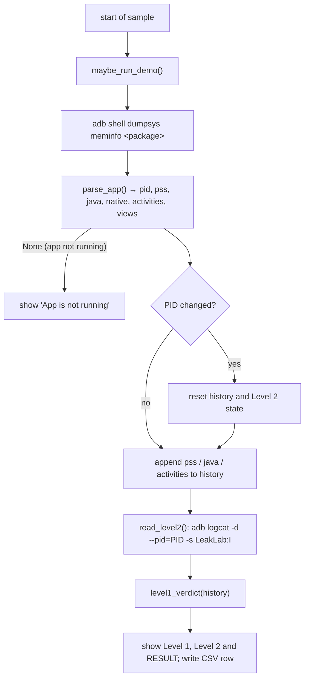
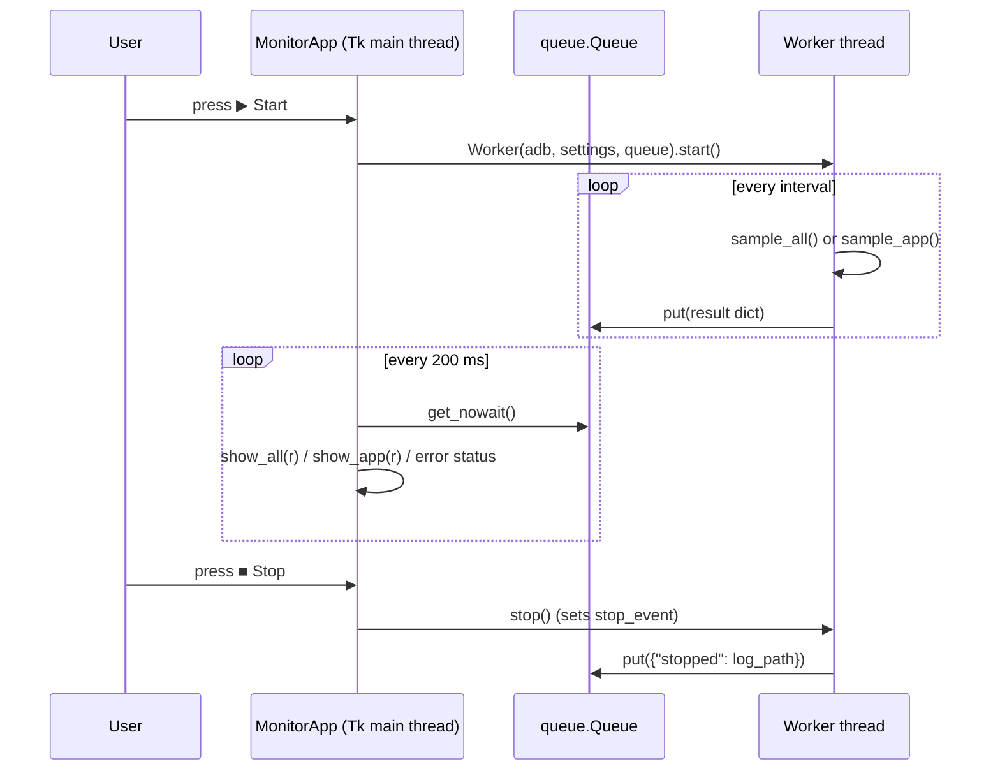

# LeakLab – System Design

This document describes how LeakLab is built:
1. what the parts are;
2. how data flows between them;
3. the exact rules used to decide that something is leaking;
4. which function calls which.

For setup and usage, see [README.md](README.md). For the step-by-step build guide, see
[steps.md](steps.md).

**Contents**
1. [Overview](#1-overview)
2. [System design](#2-system-design)
3. [Workflows](#3-workflows)
4. [Detection criteria](#4-detection-criteria)
5. [Functions and calls](#5-functions-and-calls)
6. [Data formats and commands](#6-data-formats-and-commands)
7. [Constants](#7-constants)

---

## 1. Overview

LeakLab detects memory leaks on an Android phone at two levels:

| | Level 1: phone-wide | Level 2: in-app |
|---|---|---|
| Runs on | PC (Python), talks to the phone over `adb` | Inside the Android app (Kotlin + LeakCanary) |
| Looks at | OS memory accounting of **every process** (`dumpsys meminfo`) | The app's own heap and objects |
| Answers | **Which** app is leaking? | **Why** is it leaking? (reference chain) |
| Limitation | Sees *how much* memory, not *what* is in it, so it only finds suspects | Sees only the app it is built into |

The levels are connected through the Android system log (logcat). Level 2 writes its
findings there, and Level 1 reads them.

---

## 2. System design

### 2.1 Architecture



### 2.2 Components

| Component | File | Responsibility |
|---|---|---|
| Application class | [LeakLabApp.kt](LeakLab/app/src/main/java/com/iiitv/leaklab/LeakLabApp.kt) | Configures LeakCanary (dump threshold 1, plugs in `LeakReport`). Turns automatic dumps on or off. |
| LeakCanary extension | [LeakReport.kt](LeakLab/app/src/main/java/com/iiitv/leaklab/LeakReport.kt) | Receives LeakCanary events, matches traces to scenarios, checks the culprit, measures time, writes to logcat, computes the summary. |
| Test scenarios | [Scenarios.kt](LeakLab/app/src/main/java/com/iiitv/leaklab/Scenarios.kt) | 7 controlled screens (5 leaking, 2 correct), each holding a 4 MB image. |
| Global objects | [LeakyObjects.kt](LeakLab/app/src/main/java/com/iiitv/leaklab/LeakyObjects.kt) | `AppSingleton`, `EventBus` and `ScreenCache`: the long-lived holders that cause the leaks. |
| Custom watched object | [MusicPlayer.kt](LeakLab/app/src/main/java/com/iiitv/leaklab/MusicPlayer.kt) | Non-Android object watched manually after `release()`. |
| Dashboard | [MainActivity.kt](LeakLab/app/src/main/java/com/iiitv/leaklab/MainActivity.kt) | Run all, Analyse, Reset and Share buttons; scenario cards. Accepts the `run_all` command from the PC. |
| UI helpers | [Ui.kt](LeakLab/app/src/main/java/com/iiitv/leaklab/Ui.kt) | `formatMs`, `showChip`. |
| Level 1 logic + terminal | [phone_monitor.py](system_monitor/phone_monitor.py) | adb access, parsing, leak rules, Level 2 log reading, both terminal modes. |
| Level 1 window | [monitor_gui.py](system_monitor/monitor_gui.py) | Tkinter window. Reuses `phone_monitor` logic and scans in a background thread. |

### 2.3 Design decisions

| Decision | Reason |
|---|---|
| Two levels instead of one | Sandboxing stops an outside tool from seeing inside an app; an in-app tool cannot see other apps. |
| Bridge through **logcat** | The PC cannot read the app's memory, but it can read the shared system log over adb. |
| Measure **PSS**, not RSS | PSS divides shared pages among processes, so it adds up to real RAM and fairly measures each app. |
| Use the **lowest** memory value (baseline) | Memory rises and falls as the GC runs. A rising *minimum* means memory the GC cannot free. |
| 4 MB image per scenario screen | Makes each leaked screen large enough to be visible in OS numbers on a real phone (app already 100+ MB). |
| One heap dump after **Run all** | LeakCanary forgets every watched object after a dump, so dumping early would lose later leaks. |
| Remember Level 2 findings on the PC | logcat is a small ring buffer; on a busy phone old lines disappear within seconds. |
| Background thread + queue in the GUI | One phone-wide scan takes 5–10 s and would otherwise freeze the window (producer–consumer). |
| `dumpsys -t 60` | On a busy phone `dumpsys meminfo` takes more than its default 10 s limit and is cut off. |

---

## 3. Workflows

### 3.1 Level 2: detecting a leak inside the app



### 3.2 "Run all scenarios"



### 3.3 Level 1: phone-wide sampling loop (`monitor_all` / `Worker.sample_all`)



### 3.4 Level 1 + Level 2: one app (`monitor_app` / `Worker.sample_app`)



### 3.5 GUI threading (producer–consumer)



---

## 4. Detection criteria

### 4.1 Level 2 (inside the app)

**When an object counts as leaked** (LeakCanary):
1. The object's lifecycle ended. Activities are watched automatically on `onDestroy()`.
   `MusicPlayer` is watched manually in `release()` with
   `AppWatcher.objectWatcher.expectWeaklyReachable()`.
2. It is held only by a **weak reference** from the watcher.
3. **5 s later, after a GC**, the weak reference still points to it. It is then
   *retained*, because something else holds a strong reference.
4. A heap dump is taken once the number of retained objects reaches the threshold (1),
   or at the end of Run all.
5. The analyser finds the **shortest strong-reference path from a GC root** to the object.
   This path is the leak trace.

**When a trace counts as correct** (our check in `LeakReport.collectLeaks`):

```
correct  ⇔  some step in trace.referencePath satisfies
            "<originObject.classSimpleName>.<referenceName>" == scenario.culprit
```

For example, `Thread.target` in the ThreadLeakActivity trace equals the expected culprit
`Thread.target`. Passing through the right class is not enough; the field must match too.

**Scenario status** (`LeakReport.statusOf`):

| Status | Condition |
|---|---|
| `LEAK` | A leak trace was found whose leaking class equals the scenario's `watchedClass`. |
| `NOT TESTED` | The screen was never opened. |
| `WAITING` | Opened but not closed yet, or no heap dump has been analysed more than 5 s after it closed. |
| `NO LEAK` | The last analysed heap dump started more than 5 s after the screen closed, and no trace was found. |

**Evaluation metrics** (`LeakReport.summary`). These count only scenarios in `LEAK` or
`NO LEAK` status:

| Metric | Definition |
|---|---|
| Detection accuracy | scenarios where (status is LEAK) == `isRealLeak` / scenarios tested |
| False results | false positives (LEAK on a clean screen) + false negatives (NO LEAK on a leaky screen) |
| Trace accuracy | real leaks found with a correct trace / real leaks found |
| Detection time | time of the analysis result − time of `onDestroy()`, averaged over found leaks |
| Heap dump / analysis time | from LeakCanary's `HeapDump.durationMillis` and `analysisDurationMillis` |

### 4.2 Level 1 (phone-wide, from outside)

For one process with PSS samples `m1 … mn` (in KB), `WINDOW = 3`:

```
baseline growth  g = min(m[n-2], m[n-1], m[n]) − min(m1, m2, m3)
start            s = min(m1, m2, m3)
```

| Verdict | Condition (`verdict()`) |
|---|---|
| `measuring` | fewer than 6 samples (`2 × WINDOW`) |
| `LEAK?` | g ≥ 5 MB **and** g ≥ 10 % of s |
| `growing` | g > 1 MB (but not LEAK?) |
| `stable` | otherwise |

Rows are sorted LEAK? → growing → stable → measuring, then by growth (largest first).

**One-app mode** (`level1_verdict()`), checked in this order:

| Result | Condition |
|---|---|
| `measuring…` | fewer than 6 samples |
| `LEAK? – closed screens (Activities) keep piling up` | min(last 3 Activity counts) > min(first 3) |
| `LEAK? – the lowest memory value keeps growing` | `verdict(pss history) == "LEAK?"` |
| `no leak` | otherwise |

**Process restarts:** if a process's PID changes, its history starts again, so a restart
is not mistaken for growth.

**Why "LEAK?" has a question mark:** Level 1 cannot see inside an app, so an app that is
legitimately loading content looks the same as a leaking one. A Level 1 result is a
*suspect*. Only Level 2 can confirm it and name the cause.

---

## 5. Functions and calls

### 5.1 Android app (Kotlin)

#### `LeakLabApp` (Application)
| Function | Called by | Does | Calls |
|---|---|---|---|
| `onCreate()` | Android, at app start | Sets up LeakCanary: `retainedVisibleThreshold = 1`, `computeRetainedHeapSize = false`, adds `LeakReport` to `eventListeners` | `LeakReport.init()` |
| `setAutoHeapDump(enabled)` | `MainActivity.runAllScenarios()`, `LeakReport.dumpHeapWhenRunFinished()` | Sets the threshold to 1 (on) or 1000 (paused) | `LeakCanary.config.copy()` |

#### `LeakReport` (object, implements LeakCanary `EventListener`)
| Function | Called by | Does | Calls |
|---|---|---|---|
| `init(app)` | `LeakLabApp.onCreate()` | Stores app name, package, version and PID | `PackageManager` |
| `markOpened(className)` | `ScenarioActivity.onCreate()` | Marks a screen opened; clears its old close time and result | `notifyChange()` |
| `markClosed(className)` | `ScenarioActivity.onDestroy()` | Saves the close time (`uptimeMillis`) | `notifyChange()` |
| `setProgress(text, percent)` | `onEvent()`, MainActivity buttons | Updates the progress line and bar | `notifyChange()` |
| `reset()` | Reset button | Clears all state; logs `RESET` for Level 1 | `Log.i`, `setProgress()` |
| `notifyChange()` | the functions above | Calls the UI callback `onChange` | `MainActivity.render()` (through the callback) |
| `dumpHeapWhenRunFinished(runStartedAt)` | `MainActivity.runAllScenarios()`, itself | Waits until all scenarios have closed (checks every 500 ms, 60 s timeout), then dumps at last close + 6 s | `LeakCanary.dumpHeap()`, `LeakLabApp.setAutoHeapDump(true)` |
| `onEvent(event)` | LeakCanary (background thread) | Handles DumpingHeap, HeapDump, HeapAnalysisProgress, Succeeded, Failed | `setProgress()`, `collectLeaks()` |
| `collectLeaks(analysis)` | `onEvent()` | Logs `ANALYSIS` and `LEAK` lines; matches each trace to a scenario; builds the chain text; checks the culprit; computes detection time; stores a `Result` | `Log.i`, `SCENARIOS.find` |
| `resultOf(scenario)` | UI, `summary()`, `buildTextReport()` | Returns the stored `Result` or null | – |
| `statusOf(scenario)` | UI, `summary()`, `buildTextReport()` | Applies the status rules in §4.1 | – |
| `summary()` | `MainActivity.render()`, `buildTextReport()` | Computes the metrics in §4.1 | `statusOf()`, `resultOf()` |
| `buildTextReport()` | `MainActivity.shareReport()` | Plain-text report for sharing | `summary()`, `statusOf()`, `resultOf()`, `formatMs()` |

#### `MainActivity`
| Function | Called by | Does | Calls |
|---|---|---|---|
| `onCreate()` | Android | Builds the dashboard and scenario cards; wires up the buttons | `handlePcCommand()` |
| `onNewIntent(intent)` | Android (singleTop, when a command arrives from the PC) | Handles a new PC command | `handlePcCommand()` |
| `handlePcCommand(intent)` | `onCreate()`, `onNewIntent()` | If the `run_all` extra is set, removes it and runs | `runAllScenarios()` |
| `onResume()` / `onPause()` | Android | Registers / unregisters `LeakReport.onChange`. Unregistering in `onPause` stops the dashboard from leaking itself. | `render()` |
| `runAllScenarios()` | Run all button, `handlePcCommand()` | Pauses auto dumps, starts all 7 scenarios with auto-close, schedules one dump | `setAutoHeapDump(false)`, `startActivities()`, `dumpHeapWhenRunFinished()` |
| `shareReport()` | Share button | Opens the Android share sheet with the report | `LeakReport.buildTextReport()` |
| `render()` / `setStat()` / `bindCard()` | `onResume()`, `onChange` callback | Draws the summary tiles and each scenario card | `summary()`, `statusOf()`, `resultOf()`, `showChip()` |
| Analyse button | user | Requests a heap dump now | `LeakCanary.dumpHeap()` |
| Reset button | user | Clears the global references and the results (a running thread cannot be cleared, so the thread leak lasts until the thread ends) | `clearGlobalReferences()`, `LeakReport.reset()` |

#### Scenarios and leaky objects
| Function / class | Called by | Does |
|---|---|---|
| `ScenarioActivity.onCreate()` | Android | `markOpened()`, shows the scenario's code and explanation; allocates the 4 MB `screenImage` |
| `ScenarioActivity.onResume()` | Android | With `EXTRA_AUTO_CLOSE`, calls `finish()` after 300 ms |
| `ScenarioActivity.onDestroy()` | Android | `markClosed()` |
| `StaticFieldLeakActivity` | Run all / user | `AppSingleton.lastActivity = this` |
| `ListenerLeakActivity` | Run all / user | `EventBus.register { title = it }`, never unregistered |
| `CacheLeakActivity` | Run all / user | `ScreenCache.screens["cache_screen"] = this` |
| `ThreadLeakActivity` | Run all / user | Starts a thread that sleeps 10 minutes and references the Activity |
| `PlayerLeakActivity` | Run all / user | Adds a `MusicPlayer` to `PlayerRegistry.players`; `onDestroy()` calls `player.release()` |
| `FixedListenerActivity` | Run all / user | Registers a listener and unregisters it in `onDestroy()` (no leak) |
| `CleanActivity` | Run all / user | Control screen (no leak) |
| `MusicPlayer.release()` | `PlayerLeakActivity.onDestroy()` | `AppWatcher.objectWatcher.expectWeaklyReachable(this, …)` |
| `EventBus.register()` / `unregister()` | scenarios | Add to / remove from the static `listeners` list |
| `clearGlobalReferences()` | Reset button | Clears `AppSingleton`, `EventBus`, `ScreenCache` and `PlayerRegistry` |
| `scenarioFor(class)` | `ScenarioActivity.onCreate()` | Finds the `Scenario` for a screen |
| `formatMs(ms)`, `TextView.showChip()` | UI, report | Formatting helpers |

### 5.2 PC monitor (Python)

#### `phone_monitor.py`
| Function | Called by | Does | Calls |
|---|---|---|---|
| `find_adb()` | `main()` (both scripts) | Finds `adb` on PATH or in the Android SDK; exits if missing | `shutil.which` |
| `adb_run(adb, device, *args)` | everything that talks to the phone | Runs an adb command; raises `AdbError` on failure | `subprocess.run` |
| `adb_shell(adb, device, *args)` | samplers, `start_run_all()` | `adb shell …` | `adb_run()` |
| `show_adb_problem(error)` | `monitor_all()`, `monitor_app()` | Prints "Phone not reachable – retrying…" | `clear_screen()` |
| `new_level2_state()` | `monitor_app()`, `read_level2()`, `Worker.sample_app()` | Empty Level 2 memory: `{"summary": None, "leaks": {}}` | – |
| `read_level2(adb, device, pid, state)` | `monitor_app()`, `Worker.sample_app()` | Reads `LeakLab` log lines for the PID. Handles `RESET`. Stores the latest `ANALYSIS` summary and every `LEAK` (keyed by leaking class), remembered across samples. | `adb_run()` |
| `parse_all_processes(text)` | `monitor_all()`, `Worker.sample_all()` | `{name: (pid, pss_kb, state)}` from the "Total PSS by process" and "by OOM adjustment" sections | regexes |
| `parse_app(text)` | `monitor_app()`, `Worker.sample_app()` | pid, pss, java, native, activities, views (or `None` if not running) | regexes |
| `baseline_growth(values)` | `verdict()`, samplers | `min(last 3) − min(first 3)`, or `None` with fewer than 6 samples | – |
| `verdict(values)` | samplers, `level1_verdict()` | measuring / LEAK? / growing / stable (§4.2) | `baseline_growth()` |
| `level1_verdict(history)` | `monitor_app()`, `Worker.sample_app()` | One-app verdict (§4.2) | `verdict()` |
| `sparkline(values)` | terminal tables, GUI table | Text trend line using ▁▂▃▄▅▆▇█ | – |
| `mb(kb)`, `signed_mb(kb)` | output | Format KB as MB | – |
| `start_run_all(adb, args)` | `maybe_run_demo()` | `adb shell am start -n <app>/.MainActivity --ez run_all true` | `adb_shell()` |
| `maybe_run_demo(adb, args, last)` | samplers | If `--demo N` is set and N s have passed, presses Run all | `start_run_all()` |
| `monitor_all(adb, args, writer)` | `main()` (no `--app`) | Phone-wide loop (§3.3), terminal output | see §3.3 |
| `monitor_app(adb, args, writer)` | `main()` (with `--app`) | One-app loop (§3.4), terminal output | see §3.4 |
| `clear_screen()`, `wait()` | loops | Redraw the terminal; keep the sampling interval | – |
| `main()` | command line | Parses options, opens the CSV, runs a mode, stops on Ctrl+C | `find_adb()`, `monitor_all()` / `monitor_app()` |

#### `monitor_gui.py`
| Function | Thread | Called by | Does |
|---|---|---|---|
| `Worker.run()` | worker | `Worker.start()` | Opens the CSV; loop: `maybe_run_demo()` → sample → `queue.put(result)`; on `AdbError` puts `{"error"}`; at the end puts `{"stopped": path}` |
| `Worker.sample_all()` | worker | `run()` | Same logic as `monitor_all`, returns a result dict (`mode: "all"`) |
| `Worker.sample_app()` | worker | `run()` | Same logic as `monitor_app`, returns a result dict (`mode: "app"`) |
| `Worker.stop()` | main | `MonitorApp.stop()` / `on_close()` | Sets `stop_event` |
| `MonitorApp.__init__()` | main | `main()` | Builds the window; starts `poll_results()` |
| `build_controls()`, `build_all_view()`, `build_app_view()`, `make_chart()` | main | `__init__()` | Top bar, process table, Level 1/2 panels, RESULT box |
| `show_view()` | main | mode radio buttons, `open_app_from_table()` | Switches between the All apps and One app views |
| `toggle()`, `start()`, `stop()` | main | Start/Stop button | Validates settings; creates and starts or stops the `Worker` |
| `open_app_from_table()` | main | double-click on a row | Switches to One app for that package and restarts |
| `poll_results()` | main | itself, every 200 ms (`root.after`) | Drains the queue → `show_all()` / `show_app()` / status line |
| `show_all(r)` | main | `poll_results()` | Fills the process table (colour by verdict, red = LEAK?) |
| `show_app(r)` | main | `poll_results()` | Fills Level 1 values and charts, the Level 2 table and the RESULT box |
| `draw_chart(canvas, values, color)` | main | `show_app()` | Line chart of the last 40 samples |
| `on_close()` | main | window close | Stops the worker, closes the window |

### 5.3 Cross-system call chain (one leak, end to end)

```
User/PC: Run all
 └─ MainActivity.runAllScenarios()
     ├─ LeakLabApp.setAutoHeapDump(false)
     ├─ startActivities(...)  → ListenerLeakActivity.onCreate()
     │                            ├─ LeakReport.markOpened()
     │                            └─ EventBus.register { … }        ← the leak
     │                         → onResume() → finish() → onDestroy()
     │                            └─ LeakReport.markClosed()
     └─ LeakReport.dumpHeapWhenRunFinished()
         └─ (all closed + 6 s) LeakCanary.dumpHeap(); setAutoHeapDump(true)
             └─ LeakReport.onEvent(HeapAnalysisSucceeded)
                 └─ collectLeaks()
                     ├─ Log.i("LeakLab", "LEAK … cause=EventBus.listeners …")   → logcat
                     └─ results[...] = Result(traceCorrect = true, …)            → dashboard

PC: Worker.sample_app() / monitor_app()
 ├─ adb_shell("dumpsys", "meminfo", pkg) → parse_app()  → Activities count rises
 ├─ read_level2()  ← adb logcat -s LeakLab:I              → cause: EventBus.listeners
 └─ level1_verdict() → "LEAK? – closed screens keep piling up"
     ⇒ RESULT: which = LeakLab, why = EventBus.listeners
```

---

## 6. Data formats and commands

### 6.1 adb commands used

| Purpose | Command |
|---|---|
| All processes | `adb shell dumpsys -t 60 meminfo` |
| One app | `adb shell dumpsys meminfo <package>` |
| Level 2 findings | `adb logcat -d --pid=<pid> -s LeakLab:I` |
| Press Run all | `adb shell am start -n com.iiitv.leaklab/.MainActivity --ez run_all true` |

### 6.2 Log lines (Level 2 → Level 1)

```
I LeakLab : ANALYSIS leaks=5 dump_ms=2543 analysis_ms=3554
I LeakLab : LEAK object=com.iiitv.leaklab.ListenerLeakActivity cause=EventBus.listeners screen=ListenerLeakActivity
I LeakLab : RESET
```

`cause` is LeakCanary's `leak.shortDescription`. `screen` is the scenario that created the
leak, or `-` if the object is not one of ours.

### 6.3 CSV logs (`system_monitor/logs/memory_<date>_<time>.csv`)

| Mode | Columns |
|---|---|
| All apps | `time, process, pid, state, pss_kb` (one row per process per sample) |
| One app | `time, app, pid, pss_kb, java_kb, native_kb, activities, views, level2_leaks` |

---

## 7. Constants

| Constant | Value | Where | Meaning |
|---|---|---|---|
| `AUTO_DUMP_THRESHOLD` | 1 | LeakLabApp | Dump the heap as soon as 1 object is retained |
| `NO_AUTO_DUMP` | 1000 | LeakLabApp | Effectively pauses auto dumps during Run all |
| `WATCH_DELAY_MS` | 5 000 ms | LeakReport | LeakCanary's wait before "retained" |
| `RUN_TIMEOUT_MS` | 60 000 ms | LeakReport | Give up waiting for screens to close |
| poll / extra delay | 500 ms / +1 000 ms | LeakReport | Run-all close check; margin after the watch delay |
| `AUTO_CLOSE_DELAY_MS` | 300 ms | ScenarioActivity | Auto-close delay during Run all |
| `screenImage` | 4 MB | ScenarioActivity | Makes a leaked screen visible to Level 1 |
| `LOG_TAG` | `LeakLab` | LeakReport | logcat tag read by Level 1 |
| `LEAK_MB` / `LEAK_PCT` | 5 MB / 10 % | phone_monitor | LEAK? thresholds |
| `WINDOW` / `MIN_SAMPLES` | 3 / 6 | phone_monitor | Baseline window; samples before a verdict |
| `--interval` | 10 s (GUI min 3 s) | both scripts | Time between samples |
| `dumpsys -t` | 60 s | both scripts | Allowed time for the phone-wide memory report |
| GUI poll | 200 ms | monitor_gui | How often the window reads the queue |
